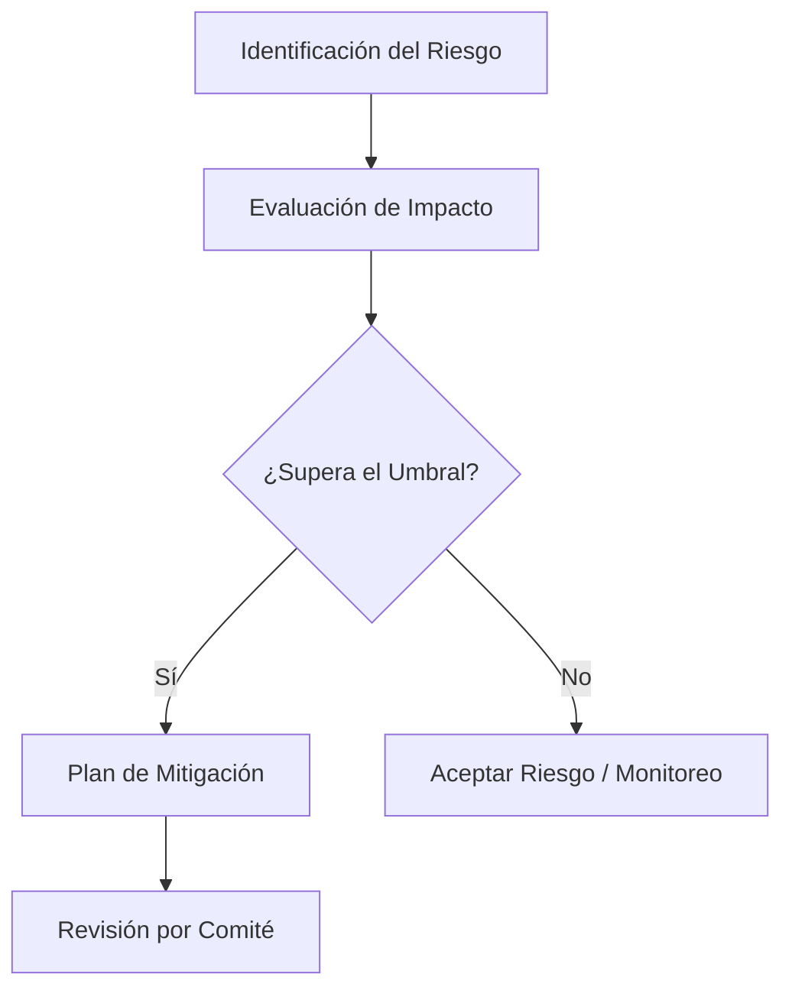
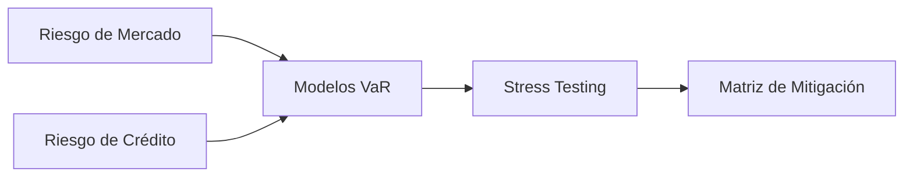

# 📊 Diagramas Visuales con Mermaid en Obsidian

Obsidian admite de forma nativa la sintaxis **Mermaid**, lo que te permite crear diagramas de flujo, mapas conceptuales y esquemas de riesgo mediante texto.

---

## 1. Flujo de Trabajo en Análisis de Riesgos

## 2. Mapa de Conexión de Riesgos

---
- Regresar al [[Índice Principal]]
