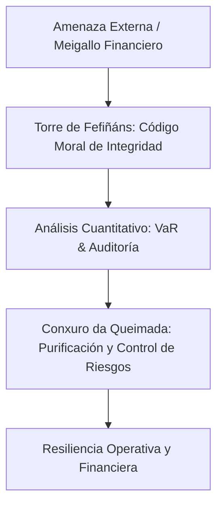

# 🔮 Manual Definitivo de Obsidian: Control, Sabiduría y Gestión de Riesgos

---

## 1. 🏛️ La Inscripción Histórica del Pazo de Fefiñáns (Cambados)

El **Pazo de Fefiñáns** (siglo XVI-XVII), situado en la emblemática Praza de Fefiñáns en Cambados (Pontevedra), alberga en los sillares de su **Torre del Homenaje** (torre almenada del siglo XVI) una de las inscripciones morales y humanistas más fascinantes de Galicia.

Originalmente labrada en **castellano del Siglo de Oro**, este código de conducta señorial ha sido adoptado popularmente en toda Galicia como un símbolo de sabiduría, integridad y autogobierno.

---

### 📜 Texto Original Histórico de la Torre (Castellano Antiguo / Español)

> **"Conócete a ti mismo.  
> Por semejanza a Dios procede como hechura de su mano.  
> Huye del vicio.  
> Busca la virtud.  
> Aborrece el ocio.  
> Ama el trabajo.  
> No seas soberbio, antes humilde.  
> No mientas porque es la mayor vileza de los viles.  
> Procura los amigos mejores que tú,  
> pues con esto y verdad, secreto y limpieza de alma,  
> nos sucede bien."**

---

### 📜 Adaptación y Versión Tradicional en Gallego

> **"Coñécete a ti mesmo.  
> Por semellanza a Deus procede como feitura da súa man.  
> Fuxe do vicio.  
> Busca a virtude.  
> Aborrece o ocio.  
> Ama o traballo.  
> Non sexas soberbio, antes humilde.  
> Non mintas porque é a maior vileza dos vís.  
> Procura os amigos mellores ca ti,  
> pois con isto e verdade, segredo e limpeza de alma,  
> nos sucede ben."**

---

### 💡 Aplicación Directa al Decálogo del Gestor de Riesgos

Cada uno de los preceptos esculpidos en la piedra de Fefiñáns tiene una correspondencia directa con las mejores prácticas en gestión integral de riesgos:

1. **"Conócete a ti mismo" (*Coñécete a ti mesmo*):**  
   *Auditoría interna y gobierno de datos:* Antes de culpar a los mercados o al entorno macroeconómico, conoce a fondo las vulnerabilidades de tu propio balance, la concentración de tu cartera y las debilidades de tus modelos.
2. **"Huye del vicio" (*Fuxe do vicio*):**  
   *Apalancamiento y arbitraje imprudente:* Evita incentivos perversos de corto plazo, excesos de apalancamiento o tomar riesgos desmedidos ignorando las colas de la distribución (*tail risk*).
3. **"Busca la virtud" (*Busca a virtude*):**  
   *Cultura de cumplimiento y solvencia:* Mantén niveles de capital y liquidez robustos por encima de los requerimientos mínimos regulatorios (Basilea).
4. **"Aborrece el ocio" (*Aborrece o ocio*):**  
   *Monitorización continua:* El riesgo financiero, operacional o cibernético nunca descansa. La supervisión de métricas (KRI, VaR, límites de crédito) debe ser activa e ininterrumpida.
5. **"Ama el trabajo" (*Ama o traballo*):**  
   *Rigor cuantitativo:* Validación permanente de modelos (*backtesting*), diseño de escenarios extremos de estrés y revisión constante de matrices de impacto.
6. **"No seas soberbio, antes humilde" (*Non sexas soberbio, antes humilde*):**  
   *Humildad epistémica ante la incertidumbre:* Ningún modelo estadístico predice el futuro con certeza total. Los *cisnes negros* existen.
7. **"No mientas porque es la mayor vileza de los viles" (*Non mintas...*):**  
   *Transparencia y reporte veraz:* Prohibido ocultar exposiciones fuera de balance o maquillar pérdidas. La honestidad en el *reporting* a reguladores y comités salva instituciones.
8. **"Procura los amigos mejores que tú" (*Procura os amigos mellores ca ti*):**  
   *Selección de contrapartes de calidad:* Mitigación de riesgo de crédito y riesgo de concentración trabajando con proveedores, custodios y socios solventes.
9. **"Pues con esto y verdad, secreto y limpieza de alma, nos sucede bien":**  
   *Confidencialidad y solidez reputacional:* Ciberseguridad, gobierno corporativo ético y salvaguarda de la información crítica para garantizar la resiliencia a largo plazo.

---

## 2. 🔥 O Conxuro da Queimada (Texto Completo Integró)

En la tradición popular gallega, la *Queimada* es un ritual de purificación mediante el fuego y el aguardiente donde se recita un conjuro destinado a espantar a las *meigas*, los *diaños*, los espíritus malignos y los *meigallos*. 

En el ámbito del riesgo, **las Pruebas de Estrés (Stress Testing), la Auditoría y el VaR son el "Conxuro da Queimada" del gestor de riesgos**: herramientas para purificar el balance, destilar los sesgos y ahuyentar los imprevistos financieros.

### 📜 Texto Completo en Gallego

> Mapeas, coruxas, sapos e bruxas.  
> Diaños, corvos, follets e meigas.  
> Opostos de maios e de bruxas.  
> Cunchas, encantamentos e feitizos.  
> Cunchas de mortos, lumes de santelmo.  
> Puchar de defuntos, peidos dos infernais diaños.  
> Bafo da fera, uivos da tempestade.  
> Opostos do can, uivo do lobo.  
> Mapeas e miñocas, pavor e medo.  
> Lumes das burning candeas,  
> forzas do ar, da terra e do mar.  
> 
> Lume desta queimada, lumes da nosa terra,  
> lume que purifica as nosas almas  
> e afasta todos os males de noso corpo e do noso pensamento.  
> 
> Cando este brebaxe baixe polas nosas gorxas,  
> quedaremos libres dos males da nosa alma  
> e de todo meigallo.  
> 
> Forzas do ar, da terra, do mar e do lume,  
> a vos fago esta chamada:  
> se é certo que tedes máis poder que a humana xente,  
> eiquí e agora, facede cos espíritos dos amigos que están fóra,  
> participen con nós desta Queimada.

---

### 📜 Texto Completo Traducido al Español

> Búhos, lechuzas, sapos y brujas.  
> Demonios, cuervos, duendes y meigas.  
> Conjuros de mayo y de brujas.  
> Podredumbres, encantamientos y hechizos.  
> Calaveras de muertos, luces de san telmo.  
> Podredumbre de difuntos, pedos de los infernales demonios.  
> Aliento de la fiera, aullidos de la tempestad.  
> Aullido del perro, aullido del lobo.  
> Lechuzas y lombrices, pavor y miedo.  
> Luces de velas ardientes,  
> fuerzas del aire, de la tierra y del mar.  
> 
> Fuego de esta queimada, fuegos de nuestra tierra,  
> fuego que purifica nuestras almas  
> y aleja todos los males de nuestro cuerpo y de nuestro pensamiento.  
> 
> Cuando este brebaje baje por nuestras gargantas,  
> quedaremos libres de los males de nuestra alma  
> y de todo hechizo (meigallo).  
> 
> Fuerzas del aire, de la tierra, del mar y del fuego,  
> a vosotras hago esta llamada:  
> si es cierto que tenéis más poder que la humana gente,  
> aquí y ahora, haced que los espíritus de los amigos que están fuera,  
> participen con nosotros de esta Queimada.

---

## 3. ⚡ La Magia de Obsidian: Wiki-Links y Grafo

Obsidian permite construir una base de conocimiento viva mediante archivos Markdown locales.

- **Conexiones `[[ ]]`:** Vincula cualquier término escribiendo `[[Riesgo de Crédito]]`.
- **Vista de Grafo (`Ctrl + G`):** Muestra el mapa de red visual de tus notas. Si una amenaza o "meigallo" afecta a un área, verás de inmediato el impacto propagado.

---

## 4. 🛡️ Bloques de Advertencia (Callouts): Evaluando Amenazas

> [!NOTE] Principio de Fefiñáns (Conócete a ti mismo / Coñécete a ti mesmo)
> Audita siempre la calidad de tus datos internos antes de aplicar cualquier modelo complejo.

> [!WARNING] Alerta de Volatilidad (Sapos e Bruxas de Mercado)
> El VaR ha superado el límite permitido debido a tensiones geopolíticas y tipos de interés.

> [!DANGER] Amenaza Crítica (Meigallo Tecnológico)
> Fuga masiva de información o ataque de ransomware. Requiere la activación inmediata del protocolo de contingencia.

---

## 5. 🛠️ Tabla de Atajos de Teclado Imprescindibles

| Acción | Atajo (Windows) | Aplicación Práctica |
| :--- | :--- | :--- |
| **Paleta de Comandos** | `Ctrl + P` | Acceso total a las funciones del programa |
| **Buscador de Notas** | `Ctrl + O` | Navegación ultra rápida entre informes |
| **Vista de Grafo** | `Ctrl + G` | Análisis visual de la interconexión de riesgos |
| **Modo Edición / Lectura**| `Ctrl + E` | Cambiar entre redactar y presentar a dirección |

---

## 6. 📊 Diagrama de Flujo: El Ritual de Protección del Riesgo

---
- Volver al [[Índice Principal]]
