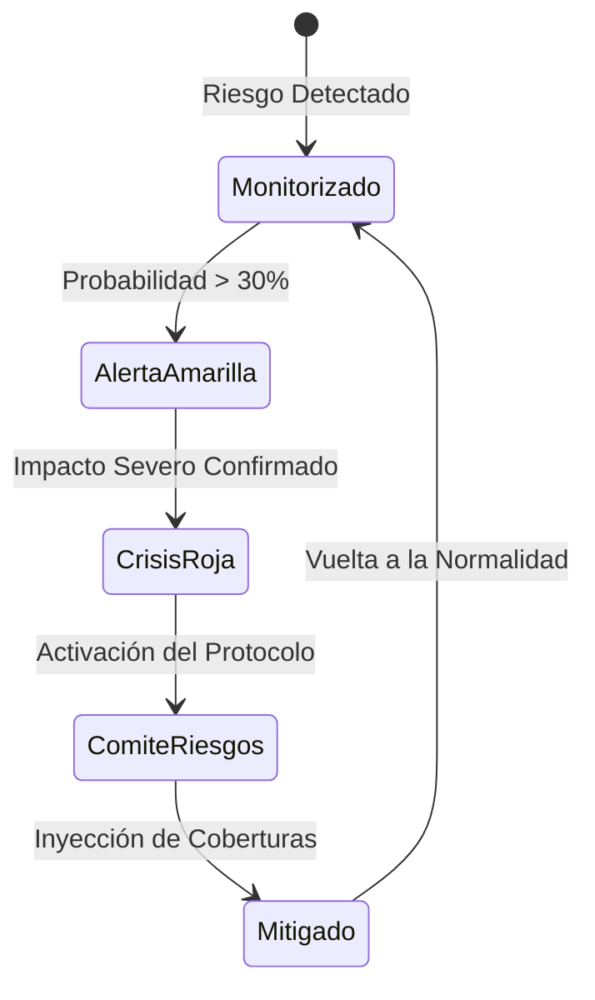

# 🗺️ Artefacto 3: Matriz Visual Heatmap de Riesgo Dinámico

Este artefacto enseña a los alumnos cómo diseñar un **mapa de calor matricial de impacto y probabilidad** utilizando las capacidades de presentación de Obsidian y Markdown enriquecido:

| Probabilidad \ Impacto | 1 - Insignificante | 2 - Menor | 3 - Moderado | 4 - Mayor | 5 - Catastrófico |
| :--- | :---: | :---: | :---: | :---: | :---: |
| **5 - Casi Seguro** | 🟡 Moderado | 🟠 Alto | 🔴 Crítico | 🔴 Extremo | 🔴 Inadmisible |
| **4 - Probable**    | 🟢 Bajo | 🟡 Moderado | 🟠 Alto | 🔴 Crítico | 🔴 Extremo |
| **3 - Posible**     | 🟢 Bajo | 🟢 Bajo | 🟡 Moderado | 🟠 Alto | 🔴 Crítico |
| **2 - Raro**        | 🟢 Mínimo | 🟢 Bajo | 🟢 Bajo | 🟡 Moderado | 🟠 Alto |
| **1 - Muy Improbable** | 🟢 Mínimo | 🟢 Mínimo | 🟢 Bajo | 🟢 Bajo | 🟡 Moderado |

---

### Flujo de Escalado Operativo de Riesgos (Mermaid)

---
- Volver al [[Índice Principal]]
